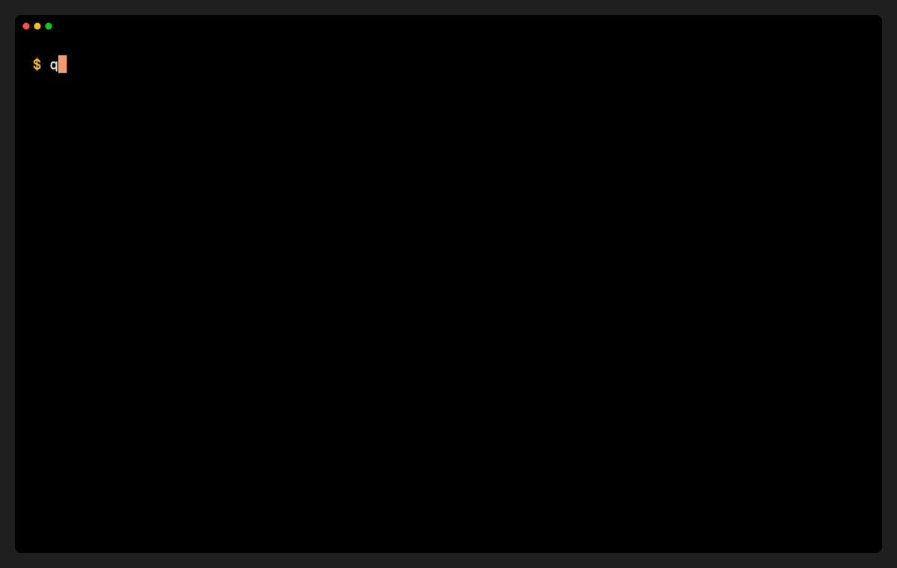

# qwen-chat

A terminal chat client for a local [ollama](https://ollama.com) model that renders answers as Markdown, with LaTeX maths turned into Unicode.



## Dependencies

- **ollama**, required: <https://ollama.com>, or `brew install ollama` on macOS.
- **A model**, required: `ollama pull qwen3.5:4b` (about 4 GB). Any other model works with `--model` or `QWEN_MODEL`.
- **utftex**, optional, for LaTeX maths: `brew install utftex`. Without it LaTeX is shown as written.
- **A truecolour terminal**, for the exact colours.
- **Go 1.27+**, only if you install with `go install`.

It is a single static binary: no Python, glow or other runtime is needed.

## Install

Download the archive for your platform from the [releases page](https://github.com/thomaspmurphy/qwen-chat/releases) and put the binary on your `PATH`:

```sh
tar -xzf qwen-chat_*_darwin_arm64.tar.gz qwen-chat
mkdir -p ~/.local/bin && mv qwen-chat ~/.local/bin/
```

On macOS, a downloaded binary is quarantined; clear the flag once:

```sh
xattr -d com.apple.quarantine ~/.local/bin/qwen-chat
```

Or build it with Go:

```sh
go install github.com/thomaspmurphy/qwen-chat@latest
```

## Usage

```sh
qwen-chat                              # interactive chat
qwen-chat how do I reverse a list in elixir
cat lib/foo.ex | qwen-chat explain this
qwen-chat -q 'capital of peru?'          # quick: no reasoning
qwen-chat -d prove sqrt 2 is irrational  # deep: bigger model
qwen-chat --model llama3.2 --no-think 'one-line haiku about tea'
```

In the interactive chat:

- `/bye`, `/exit`, `/quit` or ctrl-d quit
- `/clear` forgets the conversation
- `/think` prints the last reply's reasoning
- `/quick`, `/default`, `/deep` switch mode for the next messages, keeping the conversation
- `"""` opens and closes a multi-line message
- ctrl-c during a reply cancels it

While the model works, a status line on stderr shows `thinking Ns`, then `writing`. If ollama is not running and the host is local, qwen-chat starts `ollama serve` in the background (log in `~/.local/state/ollama/serve.log`), with flash attention and a q8_0 KV cache unless `OLLAMA_FLASH_ATTENTION` or `OLLAMA_KV_CACHE_TYPE` are set.

When stdout is not a terminal, the answer is printed as plain Markdown.

## Modes

| Mode | Flag | Chat command | Default model | Download | Thinking | Context |
| --- | --- | --- | --- | --- | --- | --- |
| quick | `-q`, `--quick` | `/quick` | `qwen3.5:4b` | about 4 GB | off | 8192 |
| default | | `/default` | `qwen3.5:4b` | about 4 GB | on | 8192 |
| deep | `-d`, `--deep` | `/deep` | `qwen3.6:35b-a3b` | about 20 GB | on | 16384 |

Only the default model needs pulling to get started; quick uses the same one. Deep is opt-in: run `ollama pull qwen3.6:35b-a3b` if you want it. Nothing is downloaded automatically; a missing model prints the `ollama pull` command to run.

`--model` replaces the active mode's model. Piped input raises the context to at least 16384. The model stays loaded for 30 minutes after each reply, so the next one-shot starts quickly.

## Flags and environment

| Flag | Environment | Default |
| --- | --- | --- |
| `--host` | `OLLAMA_HOST` | `http://127.0.0.1:11434` |
| `--model` | `QWEN_MODEL` | `qwen3.5:4b` (default mode) |
| | `QWEN_QUICK_MODEL` | `qwen3.5:4b` |
| | `QWEN_DEEP_MODEL` | `qwen3.6:35b-a3b` |
| | `QWEN_KEEP_ALIVE` | `30m` |
| `-q`, `--quick` | | off |
| `-d`, `--deep` | | off |
| `--no-think` | | reasoning on |
| `--version` | | |

## Licence

MIT
